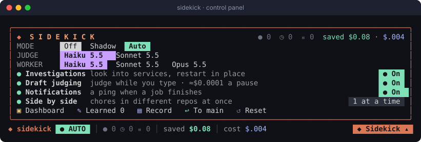
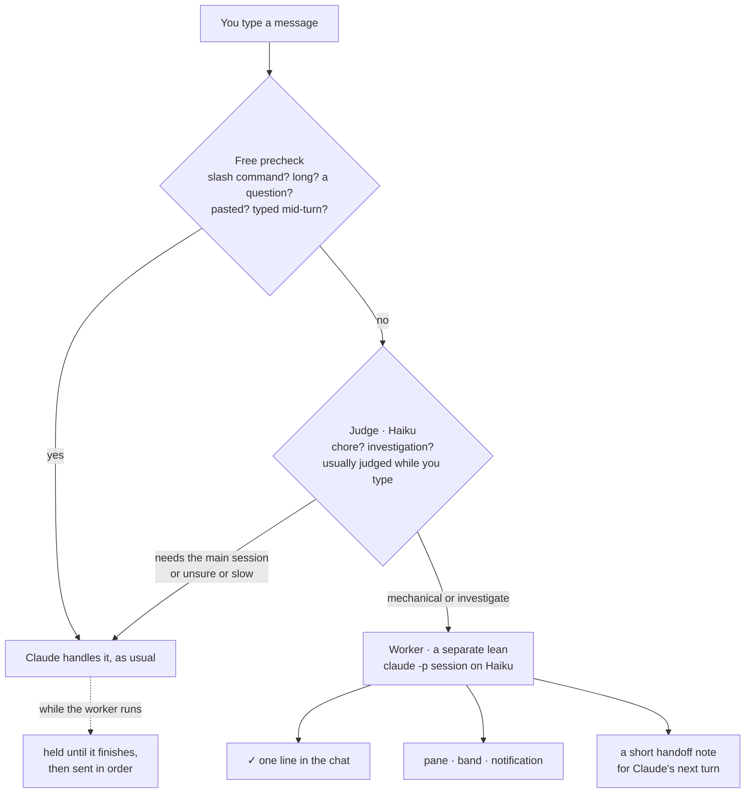
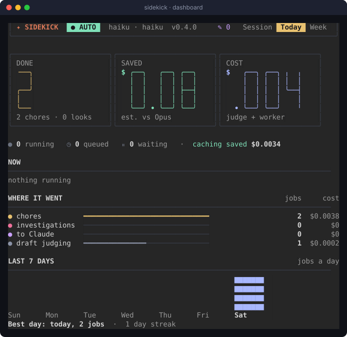

# sidekick

**A cheap, fast helper for Claude Code that takes the chores so your main session doesn't have to.**

Turn it on and keep typing as usual. When you send a mechanical chore like *"commit and push"*,
*"pull main"* or *"close the bd issue"*, a small judge model sees it's a chore and hands it to a
separate worker session. Claude never spends a turn on it, and its context stays clean. You get the
result in one line, and Claude gets a short note so it knows what happened. Everything else goes to
Claude exactly as before.

It also does **quick first-pass investigations**. When you say *"the bot stopped replying, look
into it"*, *"why did the nightly job fail?"* or *"restart acme-bot"*, the worker checks the job
manager, the logs and the project's own health scripts, restarts in place if that's needed (or
asked for), and checks that the service came back. Then it hands back what it found, with a full
record Claude can read if the answer isn't enough.



<sub>A real session. The one line above the prompt says what the sidekick is doing, and **◆ Sidekick ▾**
opens this control panel in place: mode, models, settings and shortcuts, all one click away.</sub>

---

## Contents

- [At a glance](#at-a-glance)
- [Install](#install)
- [Quick start](#quick-start-60-seconds)
- [How it works](#how-it-works)
- [What it will and won't do](#what-it-will-and-wont-do)
- [Looking into things](#looking-into-things)
- [The band and the control panel](#the-band-and-the-control-panel)
- [The dashboard](#the-dashboard)
- [Modes](#modes)
- [Typing while it works](#typing-while-it-works)
- [Teaching the judge](#teaching-the-judge)
- [Cost and caching](#cost-and-caching)
- [Configuration](#configuration)
- [What gets sent where](#what-gets-sent-where)
- [Limits](#limits)
- [Troubleshooting](#troubleshooting)
- [FAQ](#faq)
- [Working on it](#working-on-it)
- [Changelog](#changelog)

---

## At a glance

| | |
|---|---|
| ⚡ **Hands off chores** | git and `bd` chores run in a separate worker session, and the main model never sees them |
| 🔎 **Starts investigations** | "look into it", "why did X fail", "restart X": logs, job state and health checks first, for about a cent, with a full record for Claude |
| 🧠 **Judges while you type** | A verdict is usually ready before you press Enter, so a submit waits about **0.0 s** |
| 🛟 **Fails open** | Anything unsure, slow or unclear goes to Claude, so you never lose a message |
| 🔒 **Never loses work** | Force-push, `reset --hard`, `clean`, `branch -D` and similar are blocked in the tool layer, not just discouraged |
| 👀 **Always visible** | A chat line, a band, a pane and a notification, with your words always quoted |
| 💸 **Cheap, and shows it** | About **$0.0015–0.002 per chore** on Haiku (API-equivalent), with prompt caching priced in |
| 🎚️ **Per session** | Off by default. `/sidekick auto` turns it on for that session only, in any project |

---

## Install

You need **Claude Code 2.1.308 or later** (mods support), plus `claude` and `python3` on your
`PATH`. `python3` runs the safety guard; macOS has it with the developer tools.

```bash
claude plugin marketplace add DMokong/claude-plugins
claude plugin install sidekick@dmokong-plugins
```

Then, in any Claude Code session that was already open:

```text
/reload-plugins
```

Check that it loaded: run `/sidekick`. The pane opens with the version (`v0.2.3`) at the top right.

> **Updating later:**
> `claude plugin marketplace update dmokong-plugins && claude plugin update sidekick@dmokong-plugins`,
> then `/reload-plugins` in any open session. Your session's mode and history carry over.

---

## Quick start (60 seconds)

**1. Turn it on for this session.** Click **◆ Sidekick ▾** on the line above the prompt and press
**Auto**, or type:

```text
/sidekick auto
```

The line above the prompt turns green: `◆ sidekick ● AUTO`. For the first few seconds it also says
**warming up…** while the judge opens its connection.

**2. Make a change, then type a chore.**

```text
commit and push
```

You'll see your message quoted with where it went, then the result a few seconds later:

```text
⏺ Prompt dropped by a hook: ❯ commit and push → sidekick (haiku) · judged in 0.0s
⏺ sidekick: ✓ Committed the README.md "Alerts" section as 79fc1cb on main and pushed it
  to origin/main (b2776d3..79fc1cb). · haiku · 8s · ≈$0.0015
```

("Prompt dropped by a hook" is how Claude Code labels any message a mod takes. Here it means
the sidekick took it.)

**3. Keep working.** Questions, design work and code changes go to Claude as usual. When you
next talk to Claude, it already has a short note about the commit.

**4. Open the dashboard** with `/sidekick`, or the panel's **Dashboard**, to see what it's done today
and this week, what it saved, and what it cost.

To turn it off: `/sidekick off`.

---

## How it works



1. **Precheck (free, instant).** Slash commands, long or multi-line messages, pasted images,
   "why…" or "how does…" questions (unless they're about something running: *"why did the
   nightly job fail?"* goes to the judge), and anything you type while Claude is mid-reply go straight to
   Claude. They never wait on a model.
2. **Judge (Haiku, one word).** For everything else, a small model answers `mechanical`,
   `investigate`, `needs-main` or `unclear`. It starts judging your **draft** as soon as you pause typing, so the
   verdict is usually ready when you press Enter. A submit never waits more than 5 s. A slow or
   failed judge sends the message to Claude.
3. **Worker (Haiku, separate session).** A headless `claude -p` session runs in your repo with a
   lean setup: no MCP servers, skills, hooks or plugins, and only Bash/Read/Glob/Grep, limited to
   `git`, `bd` and a few read-only helpers. It does get **the instruction files your main session
   loaded** (CLAUDE.md, rules, `@` imports), so it knows the project the way Claude does. It does
   the chore from what's on disk (`git status`, the diff, `git log`) and reports back in a fixed
   format. An investigation gets a different setup, described in
   [Looking into things](#looking-into-things).
4. **Return path.** You get a chat line, a pane entry, a band update and a notification. Claude
   gets a note of up to 700 characters (what ran, the SHAs, what changed, anything the worker was
   unsure of), so it can pick up from there.

---

## What it will and won't do

The rule is **no lost work**, not "nothing that can't be undone". Anything a later command can fix
is allowed. A bad commit can be reverted, so pushing is fine.

| ✅ The worker may | ⛔ Always blocked |
|---|---|
| `git status / diff / log / show / branch -vv` | `push --force`, `--force-with-lease`, `+refspec`, remote branch delete |
| `git add`, `commit` (message from the diff and your log style) | `reset --hard / --merge / --keep` |
| `git push` (the branch you're on), `pull`, `fetch` | `clean` |
| `stash`, `tag`, create a branch **when you ask** | `branch -D` (force-delete) |
| rebase **unpushed** commits | `checkout --` / `restore` over uncommitted changes |
| `bd` create / update / comment / close / list | `stash drop / clear`, `filter-branch`, reflog expiry, `update-ref -d`, `gc --prune` |
| `cd`, `head`, `tail`, `wc`, `ls`, `cat` (read-only helpers) | writing files by redirect (`> file`), `Edit`/`Write`, any other program |
| templates like `.env.example` | **reading credentials**: `.env`, `.env.*`, `.mcp.json`, `.netrc`, `.pgpass`, SSH keys, `*.pem`/`*.key`, by any tool (Bash, Read, Grep) |

The blocks are enforced in two layers: Claude Code's own permission rules (`dontAsk` mode with an
allowlist), and a PreToolUse guard (`bin/sidekick-guard`) that also catches a flag placed after
other arguments or chained after `&&`, and refuses credential reads whichever tool asks. If a step is refused, the worker **stops**, aborts any
half-done rebase or merge so your tree is clean, and says why. The step shows in the job's details as
`✗ refused: …`.

It also **stays on your branch**. "commit and push" commits here and pushes this branch. It
never decides to branch off or open a PR unless you ask.

**What the judge typically does** (real verdicts):

| You type | Goes to |
|---|---|
| `commit and push` · `git status` · `pull main` · `list my branches` · `close the bd issue` | **sidekick** |
| `force push main to drop the last commit` | **Claude** (destructive) |
| `rename forecast() to getForecast() across the code` | **Claude** (a code change) |
| `what does the readme say about caching?` | **Claude** (needs reading and reasoning) |
| `why might forecast() be slow?` | **Claude** (a reasoning question, so the precheck sends it without asking the judge) |

---

## Looking into things

A quick first look at something running on your machine that's failing, stopped, slow or
unknown, so that a cheap model starts the investigation and Claude takes over only if needed.

| You type | What happens |
|---|---|
| `the chat bot stopped replying overnight, look into it` | job state, pid, last exit, newest log lines, read-only health scripts |
| `why did nightly-report fail?` · `check the logs for the nightly job` | the same, aimed at that job |
| `is the healthcheck passing` · `which containers look unhealthy?` | runs the project's own checks, `docker ps`, `launchctl list` |
| `restart acme-bot` | notes its state, restarts it in place, checks that it came back |

**It knows your setup from your instruction files**, the same CLAUDE.md and rules your main
session loaded, and nothing about any project is built into the sidekick. In a session where those
files haven't been captured yet (one that started before the sidekick was installed), an
investigation goes to Claude instead, saying so.

**What it may run.** Any command the guard knows only reads, any restart in place, and your
project's own scripts (anything run by path from outside the system's folders, like
`scripts/health-check.sh`). Reads include `ps`, `lsof`, `launchctl list/print`,
`docker ps/logs/inspect`, `tail`, `grep`, `jq`, `log show`, `curl` GETs, and shell loops and
`if`s around them. A command the guard doesn't know is refused, and the report says so; it
comes back `partial` for Claude to finish. Restarts in place are allowed:
`launchctl kickstart -k`, `docker restart` / `start`, `brew services restart`, or a restart script
the project names. It restarts when you ask, or when the evidence shows a hung or dead process,
and it reports `done` only after checking the service came back: running, a new pid, fresh healthy
log lines.

**What the guard refuses in an investigation.** It works the other way round from a chore's
blocklist: anything not known to be safe is refused. Examples of what that stops, on top of
everything in the table above:

| ⛔ Refused | Because |
|---|---|
| `rm`, `rmdir`, `shred`, `truncate`, `find -delete`, `mv`, `cp`, `ln`, `touch`, `chmod`, `rsync`, `tar x`, `unzip` | deletes or writes files |
| `> file`, `tee file`, `sed -i`, `perl -i`, `dd of=`, `sort -o`, `curl -o`, `wget` to a file | overwrites file contents |
| `docker rm / rmi / stop / kill / run / … prune`, `volume rm`, `compose down`, `--force-recreate` | removes or recreates containers |
| `launchctl bootout / unload / load / remove / disable / kill`, `brew services stop` | removes or disables a job, where a restart doesn't |
| SQL that writes (`DROP`, `DELETE`, `UPDATE`, …), `dropdb`, `redis-cli FLUSHALL / DEL / SET …` | changes data |
| `kill`, `pkill`, `killall` | restarts go through the job manager |
| `curl -X POST`, `-d`, `-F`, `--json` | writes to an API (it also never posts to chat or reruns a job with side effects) |
| `sudo`, `ssh`, package installs, `npx` | root, other machines, new software |
| `python -c`, `node -e`, `osascript`, `awk 'BEGIN{system(…)}'`, `sed 'w file'`, a shell reading stdin | code the guard can't see into, or a reader's write mode |
| `X=rm; $X …`, `GIT_PAGER=…`, `git -c …`, `grm` / `gsed -i` | a command hidden in a variable, an option or a GNU alias |
| `printenv`, bare `env`, `security find-…-password` | prints environment secrets or Keychain passwords |
| `tmux send-keys`, `herdr pane run`, `make`, `diskutil erase…`, `shutdown`, an unknown tool | runs things the guard can't follow, or isn't known to be safe |
| git anything but reads | an investigation doesn't move a repo |
| another Claude session's files under `~/.claude/projects/` | private, and stale |

The guard looks inside `bash -c '…'`, `$(…)`, `<(…)`, backticks, `xargs`, `find -exec`, `watch`,
`eval`, loops and `docker exec`, and refuses a command it can't parse. **A script is the deliberate gap:** the guard
can't see inside your project's own scripts, so those are your maintainers' call, and the worker is
told to use the read-only or restart ones. The file and process rows hold for chores too.

**What comes back.** The chat line, pane, band and notification as for a chore, plus
`→ main: <what's still open>` when there is something. Claude's note ends with the path of a **full
record**: every command the worker ran and its output (each cut to 4 KB), the report and the
cost. Credentials that show up in output are redacted: API keys (Anthropic, OpenAI, AWS, Google),
Slack and GitHub tokens, JWTs, `Bearer` headers, `password=` / `token:` values and passwords in
URLs. Records live in `~/.claude/sidekick/investigations/` (or under `CLAUDE_CONFIG_DIR`),
outside any repository, and the newest 50 are kept. The pane's **`record`** button copies the
path.

**Cost.** A real healthcheck of about two dozen launchd jobs and their containers took 12 commands, 30 s and
about **$0.01**. Investigations hold no git or bd lock, so **you can keep talking to Claude while
one runs**. Two investigations never run at once.

---

## The band and the control panel

Whenever the sidekick is installed and enabled, one line sits above the prompt, **even while it's
off**, so turning it on is one click:

```text
◆ sidekick ○ OFF                                                          ◆ Sidekick ▾
◆ sidekick  ● AUTO  │ ● 1 ◷ 2 ⏸ 0 │ saved $0.08 │ cost $.004            ◆ Sidekick ▾
```

That's running, queued and held-for-Claude counts, then today's estimated saving and cost. On a
narrow terminal the cost goes first, then the saving, then the counts. The button always stays.

**While a job runs**, a card shows above the line with the job, the command the worker is on,
and what comes next:

```text
╭──────────────────────────────────────────────────────────────────╮
│ ✦ investigate acme-bot stopped replying                          │
│ ● tail -n 50 logs/acme.log                    ▮▮  Working 14s     │
│ ○ Report back to Claude                                  Next    │
╰──────────────────────────────────────────────────────────────────╯
```

**◆ Sidekick ▾ opens the control panel**, a popup that rises from the right end of the line, above the button (picture at the top). `▴` folds it, and so does
starting to type: it never stands between you and the prompt.

| Row | Does |
|---|---|
| **MODE** | Off / Shadow / Auto for this session (see [Modes](#modes)) |
| **JUDGE**, **WORKER** | Which model judges and which does the work: Haiku or Sonnet. No Opus worker: work worth Opus belongs in the main session |
| **Investigations** | Whether "look into it" messages go to the sidekick (see [Looking into things](#looking-into-things)) |
| **Draft judging** | Judge while you type, so Enter is instant. Each pause costs about $0.0001, which is the small cost that ticks up while you type. Off: messages are judged when sent, within 5 s |
| **Notifications** | A system notification when a job finishes; the chat line and band say it either way |
| **Side by side** | How many chores in different repos may run at once (1–3) |
| **LAUNCH** | Dashboard · What it learned · the last investigation record · give the last job to Claude · Reset to defaults |

**Settings stick.** What you change in the panel is kept for every future session. Only what you
change is kept: a setting you never touched follows the plugin's options (see
[Configuration](#configuration)). **Reset to defaults** forgets your changes. **MODE is per
session**: every session starts off, so a forgotten `auto` never takes chores in another project. A
change made in one session reaches your other open sessions with their next message.

The panel fits the room it has. On a short terminal (the band gets at most half the rows), it drops
its section rules and NOW and packs LAUNCH into short labels. On a narrow one it drops the settings'
notes; narrower still, the model chips read `Haiku` and `Sonnet` and the pills `On` / `Off` /
`1×`. Every control stays.

---

## The dashboard

Open it with `/sidekick` or the panel's **Dashboard**. In the fullscreen renderer it docks beside
the chat at full height; otherwise it opens above the prompt and scrolls.



- **DONE · SAVED · COST**, in big digits, for the tab you pick: **Session**, **Today** or **Week**.
  - **SAVED** is an estimate: each finished job counted as one main-session turn it didn't take,
    priced at your main model's rates and context size, minus what the sidekick spent. Stopped or
    failed jobs save nothing, and giving a job to main takes its saving back.
  - **COST** is everything the judge and worker spent, draft judging included.
- **The live strip**: running, queued, waiting, and what prompt caching saved this session.
- **NOW**: the running job and the queue.
- **WHERE IT WENT**: chores, investigations, messages passed to Claude and draft judging, as bars
  on one scale, with counts and cost.
- **LAST 7 DAYS**: jobs a day, the best day, and your streak. The history is kept 35 days, across
  sessions.
- **RECENT**: the last few jobs. Press one to open it: the worker's summary and every command it
  ran, with the job's buttons.

| Button (in a job) | Does |
|---|---|
| `edit` | Puts your message back in the prompt box (handed-off messages aren't in ↑ history, see [Limits](#limits)) |
| `watch` | The task, the judge and worker token and cost breakdown, what it was unsure of |
| `stop` | Stops a running or queued job |
| `revert` | Queues a `git revert` of the chore's commits (and pushes it if they were pushed) |
| `record` | Copies the path of an investigation's full record |
| `give to main` | Hands the job to Claude: to take over if it stopped, for context if it finished |
| `should've been sidekick` | Tells the judge it got one wrong (see [Teaching the judge](#teaching-the-judge)) |

**✎** in the dashboard's header opens what the judge has learned, with `forget` on each.

---

## Modes

| Mode | What happens | Use it to |
|---|---|---|
| `off` | Nothing. **Every session starts here.** | — |
| `shadow` | The judge runs on each message and logs what it *would* hand off, but everything still goes to Claude | Watch its judgment before trusting it |
| `auto` | Chores go to the worker, everything else to Claude | Everyday use |

Switch with `/sidekick auto | shadow | off` (`/sidekick on` means shadow), or click a MODE chip in
the control panel. The mode belongs to the session: turning it on in one session never affects another.

---

## Typing while it works

You don't have to wait for a chore to finish.

- **Another chore** joins the **QUEUED** section and runs when the current one finishes. (Running
  chores in parallel is an experimental option, see [Configuration](#configuration).)
- **Anything for Claude** is **held** while a chore runs, and sent the moment it's done, in the
  order you typed. Claude then reads the handoff notes first, so it never acts on a repo the worker is
  halfway through. Press `send now` to skip the wait. **An investigation holds nothing**: it
  doesn't touch your repo, so you can keep talking to Claude while it looks.

```text
⏺ Prompt dropped by a hook: ❯ what's the best way to test forecast()? · held for Claude until the
  sidekick finishes (/sidekick → send now)
…
› Prompt from the sidekick plugin
❯ what's the best way to test forecast()?
```

---

## Teaching the judge

If the judge sends a chore to Claude that the sidekick should have taken, press
**`should've been sidekick`** on that job (open it from **RECENT** in the dashboard, where messages
passed to Claude show with a purple mark). A toast confirms it:

```text
Noted: messages like "tidy up merged branches" go to the sidekick (chore) from now on
```

A correction about something running (*"the acme-bot logs look wrong"*) teaches **investigate**
instead of chore. The pane and `/sidekick learned` show which one each correction teaches
(`[chore]` / `[investigate]`), so a wrong guess is easy to spot and forget.

Your last 10 corrections are shown to the judge as precedents from its next call on, and they're
kept across sessions (up to 200 stored). The safety rules still apply, so a correction can't
teach it to force-push.

**Seeing and undoing what it learned.** The panel's **What it learned**, or **✎** in the
dashboard's header, lists the corrections the judge follows now, newest first, each with a
**`forget`** button. From the prompt:

```text
/sidekick learned        every stored correction, numbered, newest first
/sidekick forget 2       drop number 2; the judge stops following it from its next call
/sidekick forget all     back to the judge's defaults
```

Only the newest 10 steer the judge; older ones are stored and marked `(stored, not used)`.

---

## Cost and caching

Every judge call (draft judging and warm-ups included) and every worker run is priced at
first-party API rates. **These are API-equivalent estimates.** On a Claude subscription nothing is
billed per token; the numbers show what the same work would cost on the API.

**Typical figures** on Haiku, measured in real sessions:

| | ≈ cost |
|---|---|
| One judge call | $0.00003 |
| One chore (commit and push, ~8–12 s) | $0.0015–0.002 |
| What caching saved on that chore | about the same again |

**Prompt caching is priced the way the API prices it.** Cache reads cost 0.1× the input rate,
5-minute cache writes 1.25× and 1-hour writes 2×. The worker reports which kind it wrote (headless
Claude Code writes the 1-hour kind on a first-party login), and the estimate uses that split.
Checked against Claude Code's own `costUSD` for a run, it matches to the last digit.

**Each chore is a fresh session, but not a cold cache.** The cache is keyed by the exact prompt
prefix and the model, not by the session. Every worker run starts with the same prefix (Claude
Code's system prompt, the tool definitions and the sidekick's rules), so each chore reads what the
last one wrote. The per-run details (cwd, date, git status) are moved out of that prefix
(`--exclude-dynamic-system-prompt-sections`) so the cache holds across repos too:

| Worker run | Cache written / read | ≈ cost |
|---|---|---|
| repo A, first | 3.4k / 12.3k tokens | $0.00086 |
| repo B, straight after | 2.0k / 13.8k | $0.00059 |
| repo A again | **0** / 15.7k | $0.00021 |

**Your instruction files go where they cache.** Claude Code would put CLAUDE.md in the first user
message, next to the task, so every new chore writes it to the cache again. The sidekick puts the
same files at the end of the worker's system prompt instead, which stays cached between chores.
Measured in a repo with 28 KB of instructions:

| Worker run | Cache written / read | ≈ cost |
|---|---|---|
| CLAUDE.md the way Claude Code loads it, every chore | 11.8k / 6.0k | $0.0024 |
| **The sidekick's way**, first chore in the repo this hour | 13.1k / 4.5k | $0.0027 |
| **The sidekick's way**, every chore after | **1.1k / 16.6k** | **$0.0004–0.0005** |

The judge's prompt is too small to cache, which doesn't matter at $0.00003 a call. The cache
expires after an hour without use; the first chore after that rewrites it (at most about $0.003 on
Haiku). The sidekick never shares a cache with your main session, which runs a different model
with a different prompt.

`watch` on any entry shows its breakdown, for example:

```text
judge   in 312 · out 1 · cache read 0 · write 0 · ≈$0.000032 · caching saved ≈$0
worker  in 4 · out 160 · cache read 15.1k · write 1.6k (1h) · ≈$0.0006 · caching saved ≈$0.0012
```

---

## Configuration

Run `/config` and look for the sidekick's options, or use
`claude plugin configure sidekick@dmokong-plugins`.

| Option | Default | What it does |
|---|---|---|
| **Judge model** | `haiku` | The model that decides "chore or not". Any alias or model id. |
| **Worker model** | `haiku` | The model the worker session runs on. |
| **Parallel assists** *(experimental)* | `1` | How many chores may run at once. Above 1, chores that touch different things (another repo, the tracker) run side by side; two in the same repo still queue. |
| **Sidekick** | `on` | `off` disables `/sidekick` everywhere. |

The judge and worker are separate slots, so either can be swapped later (another model, or a
different agent entirely) without touching the rest.

`DMOKONG_MODS=0` in the environment silences every mod from this marketplace for that process.


These options are the **defaults**. A change in the [control panel](#the-band-and-the-control-panel) wins over them until **Reset to defaults**.

---

## What gets sent where

| Who | Sees |
|---|---|
| **Judge** | Your message and the current directory. Never the conversation. |
| **Worker** | Your message, your repo through the commands it runs, and the instruction files your main session loaded (CLAUDE.md, rules). Never the conversation, your MCP servers, your other plugins or your credential files. |
| **Claude (main)** | The handoff note: what ran, SHAs, changed files, open questions, and for an investigation the path of its full record (read only if Claude needs it). Never the worker's raw output in the conversation. |

All calls go through your own Claude Code login. The sidekick sends nothing anywhere else.
"Should've been sidekick" corrections are stored locally in the mod's store.

---

## Limits

- **↑ history.** A handed-off message is dropped before it reaches the main session, so it isn't
  in the up-arrow history; the mod API can't add to it. Your words always stay visible in the chat
  line, and `edit` in the pane puts them back in the prompt box.
- **The first message after turning it on** may go to Claude while the judge warms up (the line above the prompt
  says **warming up…**). Give it a few seconds the first time.
- **A busy moment can slow the judge.** If a verdict takes longer than 5 s, the message goes to
  Claude, and the job's details say `judge timed out`. Nothing is lost; press `should've been sidekick` if
  it should have been a chore.
- **Chores and first-pass investigations only.** git and bd chores, and looking into things on this
  machine. Anything that needs the conversation, your judgment or a code change goes to Claude by
  design, and so does debugging code (*"why does this function return null"*).
- **Investigations don't follow up.** One question, one answer, back to Claude. They don't
  watch, schedule or reach other machines.
- **Messages typed while Claude is mid-reply** always go to Claude.

---

## Troubleshooting

<details>
<summary><b>The pane is blank, or shows an old version</b></summary>

Run `/reload-plugins`, then `/sidekick`. The version in the dashboard's header is the version
that's actually loaded. If it isn't the latest, update (see [Install](#install)) and reload again.
From 0.2.1, state written by an older version is upgraded automatically.
</details>

<details>
<summary><b>Nothing goes to the sidekick</b></summary>

- Is it on? The band shows `◆ sidekick AUTO`. Every new session starts **off**, so run `/sidekick auto`.
- Open the dashboard, then the message under **RECENT** (purple mark). Its details say why it went to Claude: `needs the main
  session`, `judge timed out`, or a precheck reason.
- In `shadow` mode nothing is handed off. Shadow only records what *would* happen.
</details>

<details>
<summary><b>A chore stopped with "refused"</b></summary>

`watch` the entry: a `✗ refused: <command>` step shows exactly what was blocked. That's the safety
guard or the allowlist doing its job (for example, a force-push). Press `give to main` to have
Claude finish it with your normal permissions.
</details>

<details>
<summary><b>"judge timed out" keeps showing</b></summary>

The judge has 5 s at submit. Pausing for half a second before Enter lets it judge your draft
first, which makes this rare. If your setup is consistently slow, set **Judge model** to the
fastest model you have.
</details>

<details>
<summary><b>The dashboard is too small or too big</b></summary>

Drag its edge, or use your terminal's pane keys. Claude Code remembers the size you set. In the
fullscreen renderer (`CLAUDE_CODE_NO_FLICKER=1`) on a terminal of 110 columns or more, it docks
beside the chat at full height; otherwise it sits above the prompt and scrolls.
</details>

---

## FAQ

**Does the worker get my main session's context or cache?**
It gets the same **instruction files**: whatever CLAUDE.md, rules and `@` imports your main
session loaded, captured as the session builds its context (`prompt.context`), so it knows where
things live without the sidekick hardcoding anything. Your excludes and path-scoped rules apply
exactly as they do for Claude. The dashboard's last line shows what it has (`context`). If the sidekick
was installed mid-conversation, the worker runs without them until your next `/clear` or
compaction.

It doesn't get the conversation, and it shares no prompt cache with your main session: it's a
separate `claude -p` process on its own model. Its cache is shared across sidekick chores only.

**Why not fork the main conversation instead?**
A fork has no tools (it can't run git), and it would run on your main model, re-reading the whole
conversation at main-model prices for each chore. The sidekick is deliberately the opposite: cheap,
tool-capable and conversation-free, which is why it only takes chores that can be done from disk.

**Does it ever change my code?**
No. The worker has no Edit or Write tool and can't redirect output into files. A chore changes your
repo only through git (commits, pushes and the like) and your tracker through `bd`. An
investigation changes nothing but a service's running state, by restarting it.

**What happens if something goes wrong mid-chore?**
It aborts its own operation (`rebase --abort`, `merge --abort`) so your tree is how it was, stops,
and tells you. `give to main` hands the job to Claude with the worker's report attached. On a
finished entry it hands the report over **for context** instead, so Claude doesn't redo it.

---

## Working on it

```bash
claude plugin validate plugins/sidekick   # manifest + what the module hooks and calls
claude plugin test plugins/sidekick       # unit and flow tests (no model calls)
python3 -m unittest discover -s plugins/sidekick/tests   # the guard, run as the worker runs it
claude --plugin-dir plugins/sidekick      # a session with your working copy loaded
```

The screenshots in `docs/` are real sessions, captured as ANSI with `herdr pane read --format ansi`
and rendered to SVG.

---

## Changelog

| Version | |
|---|---|
| **0.4.5** | On the desktop app, the control panel marks the chosen mode, judge and worker with a check and the primary button: the desktop draws its own buttons, so the chip colours never showed there. |
| 0.4.4 | The worker is offered Haiku and Sonnet only. An Opus worker costs what the main session does, so that work belongs there. |
| 0.4.3 | The dashboard fits a narrow dock: its header moves the tabs to a second row (models and version give way first) instead of splitting words, and the bars and the 7-day chart shrink their labels and columns. Every one-line row is tested to fit from 28 to 120 columns. |
| 0.4.2 | The control panel picks its layout from the room it has: wide keeps every note, compact drops the notes and packs the shortcuts, mini also shortens the model chips and pills. No row runs over at any width. |
| 0.4.1 | The control panel pops up from the right end of the line, above its button, at a fixed width (72 columns), instead of spanning the whole band. |
| 0.4.0 | **A control panel and a dashboard.** The band folds to one line (shown even while off) and opens into a control panel: mode, judge and worker models, investigations, draft judging, notifications and side-by-side as live switches that stick across sessions, plus shortcuts. A live card shows the running job. The pane is now a dashboard: DONE / SAVED / COST tiles in big digits for the session, today or the week, where the work went, the last 7 days, and recent jobs that open into their details. A history of finished jobs is kept 35 days. |
| 0.3.0 | **Investigations**: a fourth verdict, `investigate`, for "look into it", "why did X fail" and "restart X". The worker may run any command but the guard's (which now holds the data-loss line outside git too), restarts in place and verifies, and leaves a full redacted record Claude can read. Investigations don't hold your messages to Claude. Corrections teach chore or investigate. `give to main` on a finished entry hands it over for context, with SHAs, changes and doubts. The braces rule now says what's actually refused (`@{u}` in a range). Worker sessions no longer leave saved output on disk. |
| 0.2.5 | The worker gets the instruction files your main session loaded (CLAUDE.md, rules), in its cached system prompt; the pane shows them as `context`. Credential files (`.env`, `.mcp.json`, keys) can't be read by any worker tool. The worker no longer loads auto-memory of its own. |
| 0.2.4 | The judge gets 5 s at submit instead of 1.8 s, so a cold or busy judge still hands chores to the sidekick. Learned corrections are listed in the pane (**LEARNED**) and by `/sidekick learned`, and `forget` revokes them. |
| 0.2.3 | Worker cache reuse across repos (`--exclude-dynamic-system-prompt-sections`). The worker stays on your branch. Refused steps are shown. `should've been sidekick` now teaches the judge. Roomier header. The band stays on one line and shows warm-up. A taller pane when inline. This README. |
| 0.2.2 | The loaded version shows in the pane header. |
| 0.2.1 | Upgrades session state left by older versions (fixes a blank pane after updating). |
| 0.2.0 | A sectioned pane, a band instead of a status-line entry, and cost estimates that price caching. |
| 0.1.2 | Messages passed to Claude are visible. Status shows the mode. |
| 0.1.1 | Your words are quoted in the chat line, with `edit` to recall them. |
| 0.1.0 | First release. |
