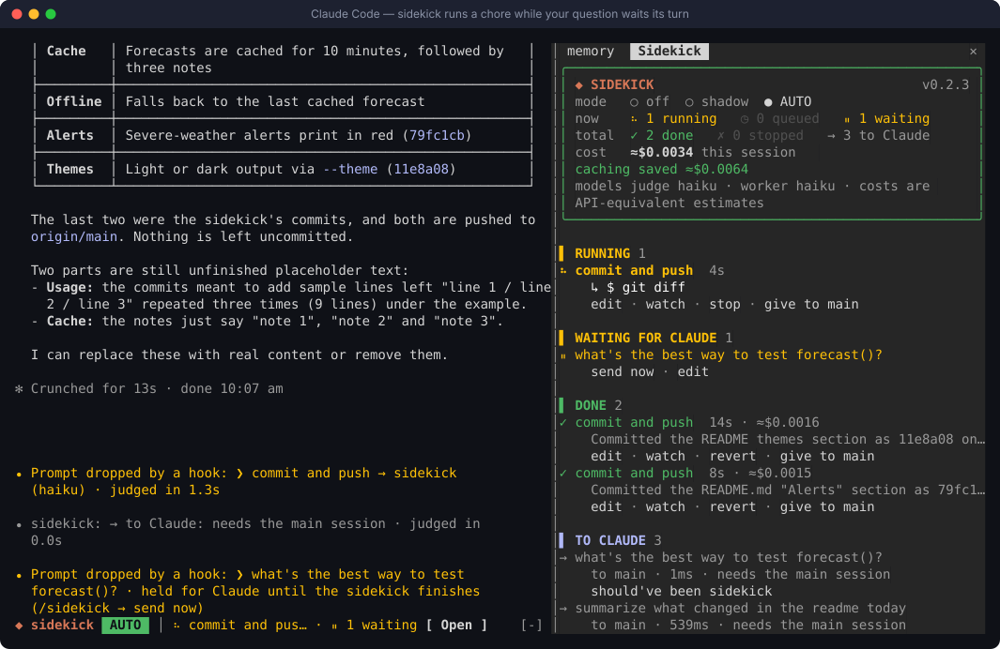
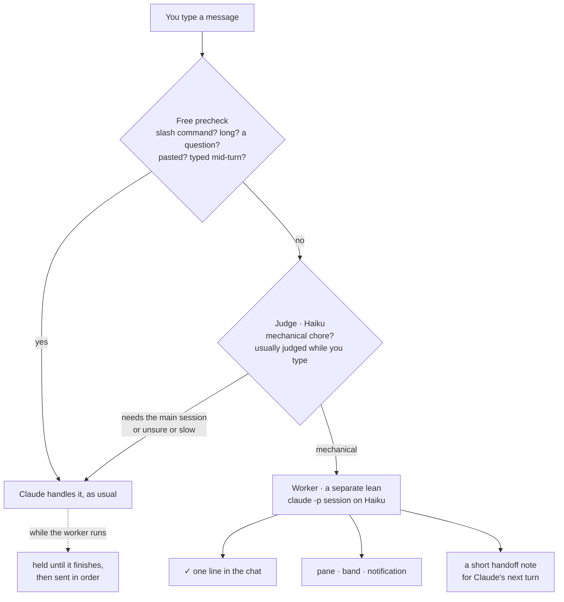
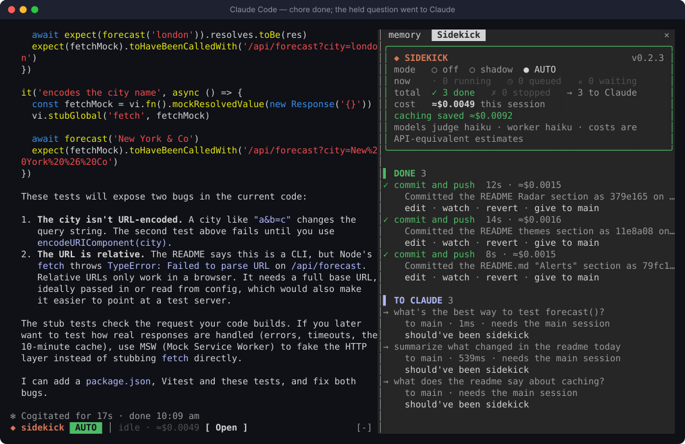

# sidekick

**A cheap, fast helper for Claude Code that takes the chores so your main session doesn't have to.**

Turn it on and keep typing as usual. When you send a mechanical chore like *"commit and push"*,
*"pull main"* or *"close the bd issue"*, a small judge model sees it's a chore and hands it to a
separate worker session. Claude never spends a turn on it, and its context stays clean. You get the
result in one line, and Claude gets a short note so it knows what happened. Everything else goes to
Claude exactly as before.



<sub>A real session. On the left, `commit and push` goes to the sidekick, and a question typed
while it runs is held, then sent to Claude. On the right, the pane shows what's running, what's
waiting, what's done and what went to Claude, with the cost.</sub>

---

## Contents

- [At a glance](#at-a-glance)
- [Install](#install)
- [Quick start](#quick-start-60-seconds)
- [How it works](#how-it-works)
- [What it will and won't do](#what-it-will-and-wont-do)
- [The pane](#the-pane)
- [The band](#the-band)
- [Modes](#modes)
- [Typing while it works](#typing-while-it-works)
- [Teaching the judge](#teaching-the-judge)
- [Cost and caching](#cost-and-caching)
- [Configuration](#configuration)
- [What gets sent where](#what-gets-sent-where)
- [Limits](#limits)
- [Troubleshooting](#troubleshooting)
- [FAQ](#faq)
- [Working on it](#working-on-it)
- [Changelog](#changelog)

---

## At a glance

| | |
|---|---|
| ⚡ **Hands off chores** | git and `bd` chores run in a separate worker session, and the main model never sees them |
| 🧠 **Judges while you type** | A verdict is usually ready before you press Enter, so a submit waits about **0.0 s** |
| 🛟 **Fails open** | Anything unsure, slow or unclear goes to Claude, so you never lose a message |
| 🔒 **Never loses work** | Force-push, `reset --hard`, `clean`, `branch -D` and similar are blocked in the tool layer, not just discouraged |
| 👀 **Always visible** | A chat line, a band, a pane and a notification, with your words always quoted |
| 💸 **Cheap, and shows it** | About **$0.0015–0.002 per chore** on Haiku (API-equivalent), with prompt caching priced in |
| 🎚️ **Per session** | Off by default. `/sidekick auto` turns it on for that session only, in any project |

---

## Install

You need **Claude Code 2.1.308 or later** (mods support), plus `claude` and `python3` on your
`PATH`. `python3` runs the safety guard; macOS has it with the developer tools.

```bash
claude plugin marketplace add DMokong/claude-plugins
claude plugin install sidekick@dmokong-plugins
```

Then, in any Claude Code session that was already open:

```text
/reload-plugins
```

Check that it loaded: run `/sidekick`. The pane opens with the version (`v0.2.3`) at the top right.

> **Updating later:**
> `claude plugin marketplace update dmokong-plugins && claude plugin update sidekick@dmokong-plugins`,
> then `/reload-plugins` in any open session. Your session's mode and history carry over.

---

## Quick start (60 seconds)

**1. Turn it on for this session.**

```text
/sidekick auto
```

The band above the prompt shows it's on. For the first few seconds it says **warming up the
judge…** while the judge opens its connection.


**2. Make a change, then type a chore.**

```text
commit and push
```

You'll see your message quoted with where it went, then the result a few seconds later:

```text
⏺ Prompt dropped by a hook: ❯ commit and push → sidekick (haiku) · judged in 0.0s
⏺ sidekick: ✓ Committed the README.md "Alerts" section as 79fc1cb on main and pushed it
  to origin/main (b2776d3..79fc1cb). · haiku · 8s · ≈$0.0015
```

("Prompt dropped by a hook" is how Claude Code labels any message a mod takes. Here it means
the sidekick took it.)

**3. Keep working.** Questions, design work and code changes go to Claude as usual. When you
next talk to Claude, it already has a short note about the commit.

**4. Open the pane** with `/sidekick` or the band's **Open** button to see everything it's done.

To turn it off: `/sidekick off`.

---

## How it works



1. **Precheck (free, instant).** Slash commands, long or multi-line messages, pasted images,
   "why…" or "how does…" questions, and anything you type while Claude is mid-reply go straight to
   Claude. They never wait on a model.
2. **Judge (Haiku, one word).** For everything else, a small model answers `mechanical`,
   `needs-main` or `unclear`. It starts judging your **draft** as soon as you pause typing, so the
   verdict is usually ready when you press Enter. A submit never waits more than 5 s. A slow or
   failed judge sends the message to Claude.
3. **Worker (Haiku, separate session).** A headless `claude -p` session runs in your repo with a
   lean setup: no MCP servers, skills, hooks or CLAUDE.md, and only Bash/Read/Glob/Grep, limited to
   `git`, `bd` and a few read-only helpers. It does the chore from what's on disk (`git status`,
   the diff, `git log`) and reports back in a fixed format.
4. **Return path.** You get a chat line, a pane entry, a band update and a notification. Claude
   gets a note of up to 700 characters (what ran, the SHAs, what changed, anything the worker was
   unsure of), so it can pick up from there.

---

## What it will and won't do

The rule is **no lost work**, not "nothing that can't be undone". Anything a later command can fix
is allowed. A bad commit can be reverted, so pushing is fine.

| ✅ The worker may | ⛔ Always blocked |
|---|---|
| `git status / diff / log / show / branch -vv` | `push --force`, `--force-with-lease`, `+refspec`, remote branch delete |
| `git add`, `commit` (message from the diff and your log style) | `reset --hard / --merge / --keep` |
| `git push` (the branch you're on), `pull`, `fetch` | `clean` |
| `stash`, `tag`, create a branch **when you ask** | `branch -D` (force-delete) |
| rebase **unpushed** commits | `checkout --` / `restore` over uncommitted changes |
| `bd` create / update / comment / close / list | `stash drop / clear`, `filter-branch`, reflog expiry, `update-ref -d`, `gc --prune` |
| `cd`, `head`, `tail`, `wc`, `ls`, `cat` (read-only helpers) | writing files by redirect (`> file`), `Edit`/`Write`, any other program |

The blocks are enforced in two layers: Claude Code's own permission rules (`dontAsk` mode with an
allowlist), and a PreToolUse guard (`bin/sidekick-guard`) that also catches a flag placed after
other arguments or chained after `&&`. If a step is refused, the worker **stops**, aborts any
half-done rebase or merge so your tree is clean, and says why. The step shows in the pane as
`✗ refused: …`.

It also **stays on your branch**. "commit and push" commits here and pushes this branch. It
never decides to branch off or open a PR unless you ask.

**What the judge typically does** (real verdicts):

| You type | Goes to |
|---|---|
| `commit and push` · `git status` · `pull main` · `list my branches` · `close the bd issue` | **sidekick** |
| `force push main to drop the last commit` | **Claude** (destructive) |
| `rename forecast() to getForecast() across the code` | **Claude** (a code change) |
| `what does the readme say about caching?` | **Claude** (needs reading and reasoning) |
| `why might forecast() be slow?` | **Claude** (a reasoning question, so the precheck sends it without asking the judge) |

---

## The pane

Open it with `/sidekick` or the band's **Open** button. On a wide terminal it docks beside the
chat, and on a narrow one it opens above the prompt (drag its edge to resize).



**Header.** The mode (click a mode to switch), what's happening **now**, session **totals**, the
session **cost** with what caching saved, the models in use, and the loaded version at the top right.

**Sections**, newest first:

| Section | Shows |
|---|---|
| ▌ **RUNNING** | A live spinner, elapsed seconds, and `↳` the command the worker is running now |
| ▌ **QUEUED** | Chores waiting for a running one to finish (see [Typing while it works](#typing-while-it-works)) |
| ▌ **WAITING FOR CLAUDE** | Your messages held until the sidekick is idle |
| ▌ **DONE** | ✓ done, ■ stopped, ✗ failed, each with time, ≈cost and the worker's summary |
| ▌ **TO CLAUDE** | Messages the judge passed on, with its reason and how long it took |

**Buttons** (where they apply):

| Button | Does |
|---|---|
| `edit` | Puts your message back in the prompt box (handed-off messages aren't in ↑ history, see [Limits](#limits)) |
| `watch` | Expands the entry: the task, every command the worker ran, any `✗ refused` step, and the judge and worker token and cost breakdown |
| `stop` | Stops a running or queued chore |
| `revert` | Queues a `git revert` of the chore's commits (and pushes it if they were pushed) |
| `give to main` | Hands the chore and the worker's report to Claude to finish |
| `send now` | Sends a held message to Claude without waiting |
| `should've been sidekick` | Tells the judge it got one wrong (see [Teaching the judge](#teaching-the-judge)) |

---

## The band

While the sidekick is on, a one-line band sits above the prompt and stacks with any other mod's
band. It adapts to width: on a narrow terminal the least useful parts drop off first.

```text
◆ sidekick  AUTO  │ warming up the judge… · ≈$0 · 0 assists [ Open ]
◆ sidekick  AUTO  │ ⠸ commit and push · $ git push · ⏸ 1 waiting · ≈$0.0017 · 1 assist [ Open ]
◆ sidekick  AUTO  │ idle · ≈$0.0049 · 3 assists [ Open ]
```

That's the first few seconds after turning it on, a chore running with a question waiting, and
nothing running.

---

## Modes

| Mode | What happens | Use it to |
|---|---|---|
| `off` | Nothing. **Every session starts here.** | — |
| `shadow` | The judge runs on each message and logs what it *would* hand off, but everything still goes to Claude | Watch its judgment before trusting it |
| `auto` | Chores go to the worker, everything else to Claude | Everyday use |

Switch with `/sidekick auto | shadow | off` (`/sidekick on` means shadow), or click the mode in
the pane. The mode belongs to the session: turning it on in one session never affects another.

---

## Typing while it works

You don't have to wait for a chore to finish.

- **Another chore** joins the **QUEUED** section and runs when the current one finishes. (Running
  chores in parallel is an experimental option, see [Configuration](#configuration).)
- **Anything for Claude** is **held** and sent the moment the sidekick is idle, in the order you
  typed. Claude then reads the handoff notes first, so it never acts on a repo the worker is
  halfway through. Press `send now` to skip the wait.

```text
⏺ Prompt dropped by a hook: ❯ what's the best way to test forecast()? · held for Claude until the
  sidekick finishes (/sidekick → send now)
…
› Prompt from the sidekick plugin
❯ what's the best way to test forecast()?
```

---

## Teaching the judge

If the judge sends a chore to Claude that the sidekick should have taken, press
**`should've been sidekick`** on that entry in **TO CLAUDE**. A toast confirms it:

```text
Noted: messages like "tidy up merged branches" go to the sidekick from now on
```

Your last 10 corrections are shown to the judge as precedents from its next call on, and they're
kept across sessions (up to 200 stored). The safety rules still apply, so a correction can't
teach it to force-push.

**Seeing and undoing what it learned.** The pane's **LEARNED** section lists the corrections the
judge follows now, newest first, each with a **`forget`** button. From the prompt:

```text
/sidekick learned        every stored correction, numbered, newest first
/sidekick forget 2       drop number 2; the judge stops following it from its next call
/sidekick forget all     back to the judge's defaults
```

Only the newest 10 steer the judge; older ones are stored and marked `(stored, not used)`.

---

## Cost and caching

Every judge call (draft judging and warm-ups included) and every worker run is priced at
first-party API rates. **These are API-equivalent estimates.** On a Claude subscription nothing is
billed per token; the numbers show what the same work would cost on the API.

**Typical figures** on Haiku, measured in real sessions:

| | ≈ cost |
|---|---|
| One judge call | $0.00003 |
| One chore (commit and push, ~8–12 s) | $0.0015–0.002 |
| What caching saved on that chore | about the same again |

**Prompt caching is priced the way the API prices it.** Cache reads cost 0.1× the input rate,
5-minute cache writes 1.25× and 1-hour writes 2×. The worker reports which kind it wrote (headless
Claude Code writes the 1-hour kind on a first-party login), and the estimate uses that split.
Checked against Claude Code's own `costUSD` for a run, it matches to the last digit.

**Each chore is a fresh session, but not a cold cache.** The cache is keyed by the exact prompt
prefix and the model, not by the session. Every worker run starts with the same prefix (Claude
Code's system prompt, the tool definitions and the sidekick's rules), so each chore reads what the
last one wrote. The per-run details (cwd, date, git status) are moved out of that prefix
(`--exclude-dynamic-system-prompt-sections`) so the cache holds across repos too:

| Worker run | Cache written / read | ≈ cost |
|---|---|---|
| repo A, first | 3.4k / 12.3k tokens | $0.00086 |
| repo B, straight after | 2.0k / 13.8k | $0.00059 |
| repo A again | **0** / 15.7k | $0.00021 |

The judge's prompt is too small to cache, which doesn't matter at $0.00003 a call. The cache
expires after an hour without use; the first chore after that rewrites it (at most about $0.003 on
Haiku). The sidekick never shares a cache with your main session, which runs a different model
with a different prompt.

`watch` on any entry shows its breakdown, for example:

```text
judge   in 312 · out 1 · cache read 0 · write 0 · ≈$0.000032 · caching saved ≈$0
worker  in 4 · out 160 · cache read 15.1k · write 1.6k (1h) · ≈$0.0006 · caching saved ≈$0.0012
```

---

## Configuration

Run `/config` and look for the sidekick's options, or use
`claude plugin configure sidekick@dmokong-plugins`.

| Option | Default | What it does |
|---|---|---|
| **Judge model** | `haiku` | The model that decides "chore or not". Any alias or model id. |
| **Worker model** | `haiku` | The model the worker session runs on. |
| **Parallel assists** *(experimental)* | `1` | How many chores may run at once. Above 1, chores that touch different things (another repo, the tracker) run side by side; two in the same repo still queue. |
| **Sidekick** | `on` | `off` disables `/sidekick` everywhere. |

The judge and worker are separate slots, so either can be swapped later (another model, or a
different agent entirely) without touching the rest.

`DMOKONG_MODS=0` in the environment silences every mod from this marketplace for that process.

---

## What gets sent where

| Who | Sees |
|---|---|
| **Judge** | Your message and the current directory. Never the conversation. |
| **Worker** | Your message and your repo, through the git and bd commands it runs. Never the conversation, your CLAUDE.md, your MCP servers or your other plugins. |
| **Claude (main)** | The handoff note: what ran, SHAs, changed files, open questions. Never the worker's raw output. |

All calls go through your own Claude Code login. The sidekick sends nothing anywhere else.
"Should've been sidekick" corrections are stored locally in the mod's store.

---

## Limits

- **↑ history.** A handed-off message is dropped before it reaches the main session, so it isn't
  in the up-arrow history; the mod API can't add to it. Your words always stay visible in the chat
  line, and `edit` in the pane puts them back in the prompt box.
- **The first message after turning it on** may go to Claude while the judge warms up (the band
  says **warming up the judge…**). Give it a few seconds the first time.
- **A busy moment can slow the judge.** If a verdict takes longer than 5 s, the message goes to
  Claude, and the pane says `judge timed out`. Nothing is lost; press `should've been sidekick` if
  it should have been a chore.
- **Chores only.** git and bd for now. Anything that needs the conversation, your judgment or a
  code change goes to Claude by design.
- **Messages typed while Claude is mid-reply** always go to Claude.

---

## Troubleshooting

<details>
<summary><b>The pane is blank, or shows an old version</b></summary>

Run `/reload-plugins`, then `/sidekick`. The version at the top right of the pane is the version
that's actually loaded. If it isn't the latest, update (see [Install](#install)) and reload again.
From 0.2.1, state written by an older version is upgraded automatically.
</details>

<details>
<summary><b>Nothing goes to the sidekick</b></summary>

- Is it on? The band shows `◆ sidekick AUTO`. Every new session starts **off**, so run `/sidekick auto`.
- Open the pane and look in **TO CLAUDE**. Each entry says why it went to Claude: `needs the main
  session`, `judge timed out`, or a precheck reason.
- In `shadow` mode nothing is handed off. Shadow only records what *would* happen.
</details>

<details>
<summary><b>A chore stopped with "refused"</b></summary>

`watch` the entry: a `✗ refused: <command>` step shows exactly what was blocked. That's the safety
guard or the allowlist doing its job (for example, a force-push). Press `give to main` to have
Claude finish it with your normal permissions.
</details>

<details>
<summary><b>"judge timed out" keeps showing</b></summary>

The judge has 5 s at submit. Pausing for half a second before Enter lets it judge your draft
first, which makes this rare. If your setup is consistently slow, set **Judge model** to the
fastest model you have.
</details>

<details>
<summary><b>The pane is too small or too big</b></summary>

Drag its edge, or use your terminal's pane keys. Claude Code remembers the size you set. On a wide
terminal the pane docks beside the chat.
</details>

---

## FAQ

**Does the worker get my main session's context or cache?**
No. It's a separate `claude -p` process on its own model with its own prompt. It shares neither
the conversation nor the prompt cache with your main session. Its cache is shared across sidekick
chores only.

**Why not fork the main conversation instead?**
A fork has no tools (it can't run git), and it would run on your main model, re-reading the whole
conversation at main-model prices for each chore. The sidekick is deliberately the opposite: cheap,
tool-capable and context-free, which is why it only takes chores that can be done from disk.

**Does it ever change my code?**
No. The worker has no Edit or Write tool and can't redirect output into files. It changes your repo
only through git (commits, pushes and the like) and your tracker through `bd`.

**What happens if something goes wrong mid-chore?**
It aborts its own operation (`rebase --abort`, `merge --abort`) so your tree is how it was, stops,
and tells you. `give to main` hands the job to Claude with the worker's report attached.

---

## Working on it

```bash
claude plugin validate plugins/sidekick   # manifest + what the module hooks and calls
claude plugin test plugins/sidekick       # unit and flow tests (no model calls)
claude --plugin-dir plugins/sidekick      # a session with your working copy loaded
```

The screenshots in `docs/` are real sessions, captured as ANSI with `herdr pane read --format ansi`
and rendered to SVG.

---

## Changelog

| Version | |
|---|---|
| **0.2.4** | The judge gets 5 s at submit instead of 1.8 s, so a cold or busy judge still hands chores to the sidekick. Learned corrections are listed in the pane (**LEARNED**) and by `/sidekick learned`, and `forget` revokes them. |
| 0.2.3 | Worker cache reuse across repos (`--exclude-dynamic-system-prompt-sections`). The worker stays on your branch. Refused steps are shown. `should've been sidekick` now teaches the judge. Roomier header. The band stays on one line and shows warm-up. A taller pane when inline. This README. |
| 0.2.2 | The loaded version shows in the pane header. |
| 0.2.1 | Upgrades session state left by older versions (fixes a blank pane after updating). |
| 0.2.0 | A sectioned pane, a band instead of a status-line entry, and cost estimates that price caching. |
| 0.1.2 | Messages passed to Claude are visible. Status shows the mode. |
| 0.1.1 | Your words are quoted in the chat line, with `edit` to recall them. |
| 0.1.0 | First release. |
